  

## Procuro meu primeiro estágio em suporte e infraestrutura de TI

Faço o Curso Técnico em Informática na Grau Técnico, em Ribeirão das Neves (MG), e termino em abril de 2027. Trabalhei um ano em atendimento ao cliente e, por conta própria, faço manutenção e montagem de computadores.

### O que já está no ar

**[Based Libes, biblioteca digital](https://github.com/Jevtx/based-libes-biblioteca-digital)** ([demo](https://basedlibes.netlify.app))
Sistema web de empréstimo de livros com três perfis de acesso, login com Google e recuperação de senha por e-mail. Foi um projeto em grupo de três pessoas, feito com apoio de IA, e o README do projeto diz o que cada um fez. Minha parte: modelagem das coleções, integração entre o site e a API, correção de bugs do backend e publicação em produção (Netlify e Render).

### O que eu já instalei e configurei

Windows, Ubuntu, Debian, Debian Server e Windows Server, em laboratório do curso. Também configurei redes e faço montagem, limpeza, formatação e manutenção de computadores.

### Estudando agora

Administração de Sistemas Operacionais II, Suporte ao Usuário, Fundamentos de Teste e Linguagem de Programação para Web.

Inglês: 65/100 no EF SET (B1/B2).

### Contato

- E-mail: guilhermejevon@gmail.com

